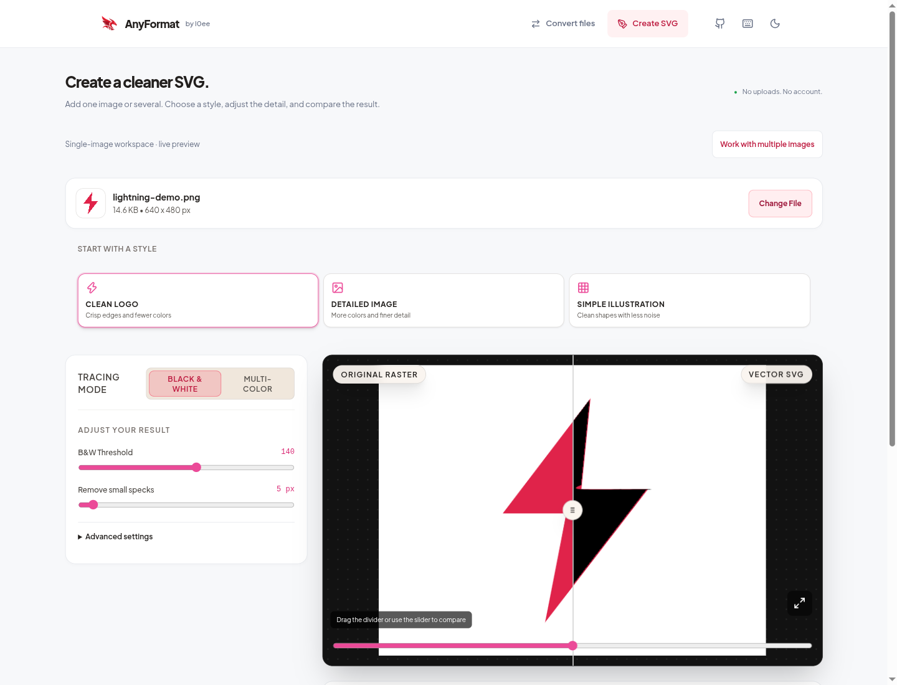

# AnyFormat

AnyFormat converts images in batches, traces images into SVGs, and exports selected PDF pages in your browser.

[Open AnyFormat](https://l0ee.github.io/anyformat/) · [Report an issue](https://github.com/l0ee/anyformat/issues)

[](https://github.com/l0ee/anyformat/actions/workflows/ci.yml)



## Workspaces

| Workspace | What it does |
| --- | --- |
| Convert files | Convert images, SVG files, and selected PDF pages. Choose an output for each file, preview results, and download individual files or a batch ZIP. |
| Create SVG | Trace one image in Vector Studio or add several to Vector Batch. Adjust colors and detail, compare the result with the original, and inspect or copy the SVG source. Batch images use shared styles and tracing settings. |

For raster inputs, PNG, JPEG, and WebP exports support resizing, including same-format exports. JPEG and WebP also have quality controls; JPEG exports let you choose a background for transparent images.

Vector Studio supports black-and-white and color tracing, palette editing, fullscreen comparison, and SVG cleanup. You can download the SVG or export the traced result as PNG or WebP at different sizes. The interface has keyboard shortcuts, light and dark themes, and reduced-motion support.

## How to use it

1. Choose Convert files or Create SVG. Select files, drag them into the upload area, or paste a supported image from your clipboard.
2. Choose an output format or tracing style. For PDFs, select the page to export. Expand the advanced controls if you need to adjust the result.
3. Preview the output, then download individual files or completed batch results as a ZIP. Native sharing is available when your browser supports it; see [mobile saving and sharing](docs/mobile-saving-and-sharing.md) for platform limits and device-test status.

Both queues can stop and resume without losing completed results. Some canvas and PDF operations finish their current browser step before stopping. Completed files remain available to download while the rest of the queue runs, and failed conversions can be retried.

## Supported formats

| Convert files input | Available outputs |
| --- | --- |
| PNG | JPEG, WebP, SVG, PDF, PNG |
| JPEG | PNG, WebP, SVG, PDF, JPEG |
| WebP | PNG, JPEG, SVG, PDF, WebP |
| BMP | PNG, JPEG, WebP, SVG, PDF |
| SVG | PNG, JPEG, WebP, PDF |
| PDF | PNG, JPEG, WebP, SVG |

Vector Studio and Vector Batch accept PNG, JPEG, WebP, BMP, and GIF for tracing. Convert files does not support GIF. BMP is an input format only. Conversion paths are defined in [`src/engine/universal/types.ts`](src/engine/universal/types.ts).

### Practical limits

- PDF conversion exports one selected page at a time. PDF-to-SVG traces an image of that page; it does not preserve the original text or vector objects.
- Tracing works best with simple logos and illustrations. Results depend on the source image and your settings; a smaller SVG file does not guarantee equivalent image quality.
- Each file can be up to 100 MB, and each queue can hold up to 100 files.
- Recognized raster headers exceeding 16,384 pixels per edge or 64 megapixels are rejected before decoding. Unknown header layouts fall back to the browser decoder. Output canvases have a smaller budget, so exports may be reduced in size. These checks do not bound the total memory used by a queue.
- Format support depends on your browser's codecs. Tailwind CSS 4 requires Safari 16.4+, Chrome 111+, or Firefox 128+. Features such as native file sharing depend on browser support.

## Privacy

Image processing and conversion run locally in your browser. AnyFormat has no file-upload backend and does not send source files to a conversion service. The site still makes network requests to load application assets and Google Fonts.

See [SECURITY.md](SECURITY.md) for rendering boundaries, memory checks, and deployment security policies. SVG cleanup is not a security sanitizer; treat exported SVGs as active content if you embed them elsewhere.

## Run locally

Use Node.js 22 (22.12 or later) and npm 10, as specified in `package.json`.

```bash
git clone https://github.com/l0ee/anyformat.git
cd anyformat
npm ci
npm run dev
```

Open the local address printed by Vite. The interface uses React 19 and TypeScript, with Vite 8 and Tailwind CSS 4. Browser Canvas and Web Workers handle image processing and tracing; PDF.js and pdf-lib handle PDFs, and JSZip creates batch downloads.

## Checks

Run the validation suite:

```bash
npm run typecheck && npm run lint && npm test
```

For Chromium browser tests:

```bash
npx playwright install chromium
npx playwright test --project=chromium
```

The full browser suite, `npm run test:e2e`, runs Chromium, Firefox, and WebKit. Install them first with `npx playwright install chromium firefox webkit`. On Debian or Ubuntu, add `--with-deps` if browser system libraries are missing. For Nobara/Fedora, see the [rootless WebKit setup](docs/webkit-on-fedora.md).

Unit tests live alongside the source files and scripts they cover; browser tests are in `tests/e2e`. The optional `npm run test:stress` checks synthetic 4K tracing with larger image buffers. See [CONTRIBUTING.md](CONTRIBUTING.md) for the development workflow and [the audit summary](docs/audit-summary.md) for test scope.

## Build and deploy

```bash
npm run build
npm start
```

The build writes to `dist`. The included Node server serves it at `http://localhost:8080` by default, with compression, caching, range requests, and security headers.

The public site runs on GitHub Pages. GitHub Actions validates changes and deploys successful builds from `main`. For another host, serve `dist` and set `VITE_SITE_URL` when building. Set `VITE_BASE_PATH` if you deploy under a subdirectory.

Website assets belong in `public`; keep unused source artwork in the ignored `design-assets` directory. GitHub releases record source versions separately from website deployments. See [CHANGELOG.md](CHANGELOG.md) for release history.

## Contributing and support

For bugs and feature requests, [open an issue](https://github.com/l0ee/anyformat/issues). Follow [CONTRIBUTING.md](CONTRIBUTING.md) for code changes and [SECURITY.md](SECURITY.md) to report security concerns privately.

AnyFormat is released under the [MIT license](LICENSE).
